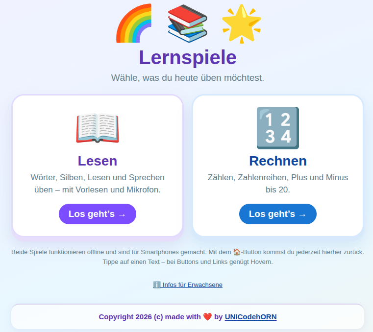
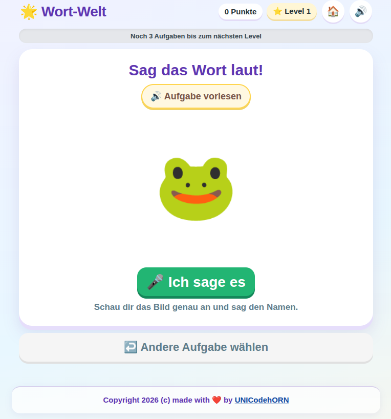
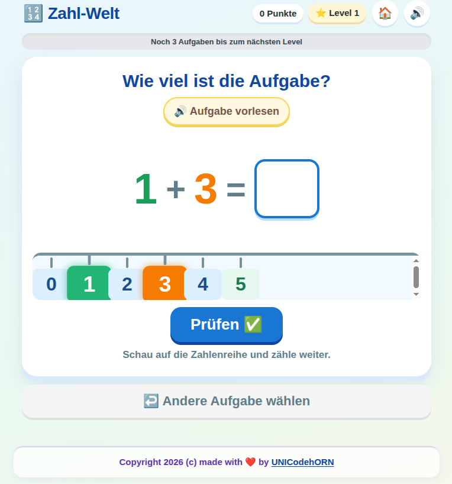

# Lernspiele für die 1. Klasse

Zwei kleine Browserspiele für Kinder in der ersten Klasse, die noch nicht lesen können: **Wort-Welt** (Lesen, Silben, Reime, Sprechen) und **Zahl-Welt** (Zählen, Zahlenreihen, Plus und Minus bis 20). Ein gemeinsames Hauptmenü führt zu beiden Spielen; der 🏠-Button bringt jederzeit zurück.

Die Spiele setzen auf Gamification: Punkte, Level mit Tier-Emojis, Fortschrittsbalken, Extra-Punkte bei drei richtigen Antworten in Folge, Konfetti, Feuerwerk und kurze Erfolgstöne. Aufgaben werden mit steigendem Level schwerer; nach zwei Fehlversuchen erscheint ein Tipp und die Aufgabe kann übersprungen werden. Alles ist für Smartphones und kleine Finger ausgelegt.

**Wichtig für Kinder:** Bei fast jedem Text genügt ein Tippen **auf den Text selbst**, damit er laut vorgelesen wird – auch bei Beschreibungen, Hinweisen und im Hauptmenü. Buttons und Links (auch „Los geht's“) werden beim **Hovern** vorgelesen; ein Klick löst nur die Aktion aus. Emojis werden nie mitgelesen. In Aufgaben, in denen ihr selbst lesen oder sprechen sollt („Sag das Wort laut“, „Wort finden“, „Lies das Wort“, „Buchstabensalat“), bleiben das gesuchte Wort und die Antworten bewusst stumm. Die Readme selbst ist bewusst *nicht* vorlesbar: Sie richtet sich an Erwachsene und wird über den Button „ℹ️ Infos für Erwachsene“ im Hauptmenü formatiert innerhalb der App angezeigt.

## Screenshots

| Hauptmenü | Wort-Welt | Zahl-Welt |
| --- | --- | --- |
|  |  |  |


## Starten

Konfiguration und Spieldaten liegen als JSON-Dateien im Projekt und werden per `fetch` geladen. Deshalb bitte einen lokalen Webserver starten (das funktioniert weiterhin ohne Internet):

```sh
cd schullernspiele
python3 -m http.server 8000
```

Danach `http://localhost:8000` im Browser öffnen. Das Mikrofon benötigt ohnehin eine sichere Umgebung (`http://localhost` oder HTTPS). Direktes Öffnen der `index.html` per `file://` wird nicht unterstützt.

Im Hauptmenü zwischen **📖 Lesen** und **🔢 Rechnen** wählen.

## Daten und Konfiguration

Alle Daten liegen unter `data/`:

| Datei | Inhalt |
| --- | --- |
| `data/words.json` | 80 Wörter mit Emoji/SVG, Silben und Reimgruppen für die Wort-Welt |
| `data/counting.json` | Zählbilder und Zahlwörter 0–20 für die Zahl-Welt |
| `data/config.json` | Legt fest, welche JSON-Dateien geladen werden, und enthält die Datenschutz-Optionen |

`data/config.json` im Auslieferungszustand:

```json
{
  "version": 1,
  "sources": {
    "lesen": "data/words.json",
    "rechnen": "data/counting.json"
  },
  "privacy": {
    "allowExternalApis": true,
    "allowMicrophone": true
  }
}
```

- `sources` enthält **relativ zum Projektstamm** die Dateien für die beiden Spiele. Wer andere Wörter, Reimgruppen oder Zählbilder verwenden möchte, legt eine eigene JSON-Datei an und trägt ihren Pfad hier ein. Die Struktur muss der der mitgelieferten Dateien entsprechen; `test/config.js` prüft das.
- `privacy.allowMicrophone: false` blockiert nur die Sprachaufnahme. Die Wort-Welt bietet dann die Aufgaben „Wort sprechen“, „Wort lesen“ und „Silben lesen“ **nicht mehr an**; auch der Mix-Modus lässt sie weg. Das Tippen als Ersatz bleibt möglich.
- `privacy.allowExternalApis: false` deaktiviert zusätzlich alle externen Dienste: Das Mikrofon wird ebenfalls abgeschaltet und die Sprachausgabe verwendet nur noch Stimmen, die der Browser ausdrücklich als lokal markiert (`localService !== false`). Ist keine lokale deutsche Stimme vorhanden, bleibt die Sprachausgabe stumm – die Spiele sind dann nur mit Erwachsenenhilfe nutzbar.
- `privacy.allowExternalApis` hat Vorrang: Ist es `false`, wird `allowMicrophone` unabhängig vom Dateiinhalt ebenfalls `false`.
- Die Zahl-Welt hat keine Mikrofon-Aufgaben; die Einstellung wirkt dort nur auf die Sprachausgabe.

Es werden ausschließlich lokale Dateien aus diesem Projekt geladen. Absolute oder externe URLs in `sources` werden abgelehnt.

## Datenschutz

Die Sprachausgabe nutzt die **Web Speech API** (`speechSynthesis`) des Browsers. Das ist eine API des Geräts bzw. Browseranbieters: Je nach Konfiguration und Betriebssystem wird der zu sprechende Text für die Sprachausgabe an einen Plattform- oder Cloud-Dienst übertragen und dort verarbeitet. Die App selbst betreibt keinen eigenen TTS-Server und speichert keine Texte.

Die Spracherkennung (`SpeechRecognition` / `webkitSpeechRecognition`) ist noch sensibler: In vielen Browsern wird dabei das aufgenommene Audio an den Browseranbieter gesendet und dort ausgewertet. Die App speichert keine Aufnahmen, übermittelt aber das Mikrofon-Audio an diesen Dienst, sofern das Mikrofon erlaubt ist.

Weil die Spiele von Kindern genutzt werden, gilt:

- Standardmäßig sind beide Mechanismen aktiv (wie in `data/config.json` gezeigt).
- Für maximale Privatsphäre `allowExternalApis: false` setzen. Dann werden keine externen Dienste für TTS oder Erkennung genutzt; nur lokal verfügbare Stimmen werden verwendet.
- Alternativ genügt `allowMicrophone: false`, wenn nur keine Stimme aufgenommen werden soll, die Sprachausgabe aber extern weiterhin erlaubt ist.
- Es gibt keine Analytics, Cookies, Werbung, Konten oder Server des Projekts.
- Die drei Effekt-Töne werden lokal per Web Audio API erzeugt; es werden keine Audiodateien heruntergeladen.

Die Hinweise für Erwachsene stehen bewusst nur in dieser Readme und werden nicht per 🔊 vorgelesen.

## Struktur

| Pfad | Inhalt |
| --- | --- |
| `index.html` | Hauptmenü mit Modulwahl und Button für die formatierte Readme |
| `lesen/` | Wort-Welt: Wörter, Silben, lesen und sprechen |
| `rechnen/` | Zahl-Welt: zählen, vergleichen, plus und minus bis 20 |
| `data/` | JSON-Daten und `config.json` |
| `shared/app.js` | Lädt Konfiguration und Daten, wertet Datenschutz-Optionen aus |
| `shared/speak.js`, `shared/speak.css` | Antippen von Texten, Hovern von Buttons/Links; Emojis und Lösungen bleiben stumm |
| `shared/markdown.js`, `shared/readme.js`, `shared/readme.css` | Formatierte Anzeige der Readme in der App |
| `shared/footer.js`, `shared/footer.css` | Copyright im Footer jeder Seite |
| `shared/audio.js` | Erfolgs-, Fehler- und Level-Töne per Web Audio API |
| `shared/module.css` | Gemeinsamer Style für den 🏠-Button |
| `test/config.js` | Prüft Konfiguration und Datendateien |
| `LICENSE` | MIT-Lizenz |

Die Module sind eigenständige Seiten mit je eigener Logik, eigenem Design und eigenen Tests. Gemeinsam genutzte Dateien liegen ausschließlich unter `shared/` und werden nicht dupliziert.

## Tests

```sh
node test/config.js
node lesen/test/smoke.js
node rechnen/test/smoke.js
```

Die Tests laufen ohne Browser und prüfen Konfiguration, Daten, Aufgaben, Antwortlogik mit festem Zufallsgenerator sowie das Rendern dieser Readme in der App.

---

Copyright 2026 (c) made with ❤️ by [UNICodehORN](https://github.com/UNICodehORN)

Derselbe Hinweis steht gut sichtbar im Footer jeder App-Seite.